<!-- perAI · Erfan Jalal — GitHub profile README -->

  

 

  
  &nbsp;
  
  &nbsp;
  
  &nbsp;
  

 

  <a href="#about"><b>About</b></a> ·
  <a href="#projects"><b>Selected work</b></a> ·
  <a href="#toolbox"><b>Toolbox</b></a> ·
  <a href="#activity"><b>Activity</b></a> ·
  <a href="#connect"><b>Connect</b></a>

 

🧭 About
I'm Erfan, an AI Engineer at perAI — an AI engineering studio in Tehran.
I build practical AI systems end-to-end: custom models trained from scratch, fine-tuned language
and multimodal models, intelligent agents that use tools and APIs, and enterprise automation that
removes manual work.
At the studio we follow one principle: "Every project has its own approach." — so every solution
starts from the client's data and constraints, not from a generic template. From data preparation and
labeling to training, evaluation and deployment, I care about the whole pipeline, and about shipping
systems people actually use.

🧩 Selected work — perAI products
Product	What it does
perVOC	Customer-voice agent — analyzes feedback and turns it into insight
perMeet	Meeting recording & documentation with speaker identification
perStock	Analysis system for the Iranian stock market
perSEO	SEO agent that grows website visibility on its own
perCast	Podcast agent — converts text into natural speech
perCRM	Intelligent customer relationship management
perOrganization	Automation of organizational processes & documents
R&D projects at the studio: Persian license-plate recognition · check detection & verification ·
text-to-image · face detection.

🧰 Toolbox
Models & data

Applied AI

Systems & delivery

📈 Activity

  
  &nbsp;
  

 

  

📡 Connect
🌐 Studio: perai.ir
💼 LinkedIn: linkedin.com/in/erfan-jalal
✉️ Email: erfan.jalal@ymail.com
---

  <b>perAI · AI Engineering Studio</b> — <i>"Every project has its own approach."</i>

